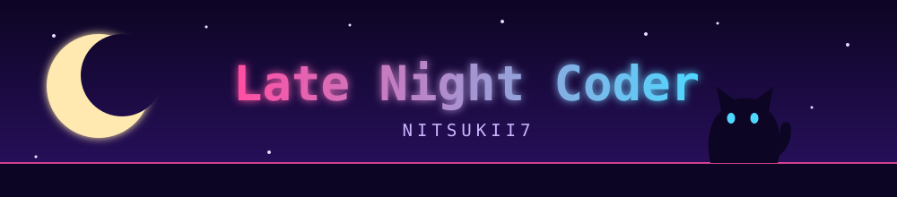
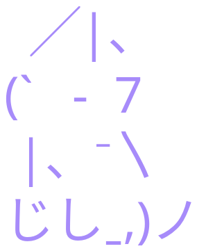
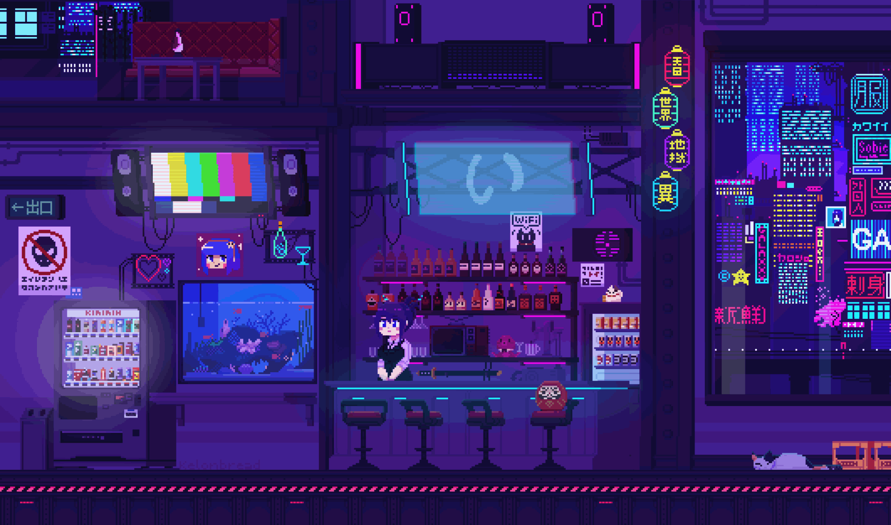

<div align="center">



🐈 cat person &nbsp;·&nbsp; 🍪 cookie lover &nbsp;·&nbsp; ☕ coffee powered &nbsp;·&nbsp; 🐧 Linux user &nbsp;·&nbsp; 🎮 Roblox developer

```text
  ,-.       _,---._ __  / \                  (   )  (
 /  )    .-'       `./ /   \                  ) (    )
(  (   ,'            `/    /|               .-------.
 \  `-"             \'\   / |               |       |--.
  `.              ,  \ \ /  |               |       |  |
   /`.          ,'-`----Y   |               |       |--'
  (            ;        |   '               '-------'
  |  ,-.    ,-'         |  /                 .-""-.
  |  | (   |        hjw | /                 ( : .: )
  )  |  \  `.___________|/                   '-..-'
  `--'   `--'
```

<p>
  
  
  
  
  
  
  <br>
  
  
  
</p>






</div>
